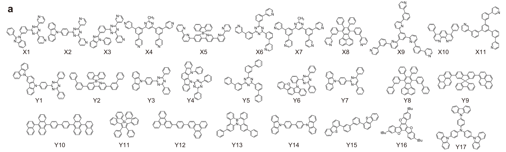

# AutoFF

- [Presentation slides for the 71st Annual Conference of the TwIChE](https://canva.link/d5f7y041ldhervg)
- [LM2D 2024 Fall Lab Training Slides](https://docs.google.com/presentation/d/1aKkIFezdlqOOn0fOBrgKWBV-Mae_nwIZ/edit#slide=id.p1)
- [Tutorial on Force Field Parameterization](https://hackmd.io/WfXhoqXRQx6BCW7P8BTjvA)
- [Progress Updates (2024.06 ~ 2024.12)](https://drive.google.com/drive/folders/1_HZIK5dIfzMJHQDqQK3O5qh8Qi8FGZIf?usp=drive_link)


> Sasaki, T., Hasegawa, M., Inagaki, K., Ito, H., Suzuki, K., Oono, T., ... & Fukagawa, H. (2021). Unravelling the electron injection/transport mechanism in organic light-emitting diodes. Nature communications, 12(1), 2706.


## Usage
1. Install the requirements:
    ```bash
    pip install -r requirements.txt
    ```

2. Clone this repo:
    ```bash
    git clone https://github.com/princesswinnie1122/AutoFF.git
    ```

3. Simply run "main.py" to call out the widget.

> You can use [MolView](https://molview.org/) to obtain the SMILES of molecules!


## References
- [rdkit.Chem.BRICS module](https://www.rdkit.org/new_docs/source/rdkit.Chem.BRICS.html)
- Degen, J., Wegscheid-Gerlach, C., Zaliani, A., & Rarey, M. (2008). On the art of compiling and using'drug-like'chemical fragment spaces. ChemMedChem, 3(10), 1503.

